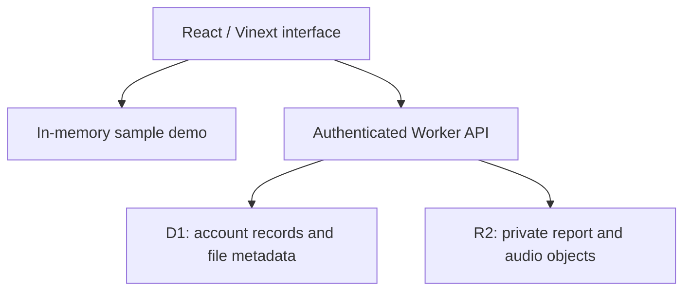

# CareCheck

**A little closer, every day.** An elder-friendly meal and medication check-in prototype for families living across countries and time zones.

CareCheck grew from a personal problem: wanting to stay involved in parents’ and grandparents’ everyday care while living abroad. It brings simple check-ins, family calling, medication organization, and visit records into one place.

> **Hackathon prototype — use fictional/sample health information only.** CareCheck records what someone reports; it does not verify medication ingestion, provide medical advice, or replace in-person care. The current hosted prototype is not for real medical records.

[Open hosted prototype](https://carecheck-family.brawnypine2.chatgpt.site) · [Judge walkthrough](docs/JUDGE_GUIDE.md)

The hosted app requires an authorized account. A repository link does not grant hosted-app access. Judges can review the source and run the sample demo locally; the presenter must arrange hosted access separately if needed. Never share account passwords.

## What works today

| Area | Implemented behavior |
| --- | --- |
| Elder interface | Large labeled buttons, Telugu-first interface with English switch, larger-text setting, two-step answer confirmation, and correction history. |
| Spoken prompts | Twelve bundled MP3 files: meal, medicine, consent, and test prompts in Telugu, Tamil, and English. **No installed device voice or API key is required for playback.** |
| Meal and tablet check-ins | “Done,” “not yet,” “help,” and meal-only “a little.” Missing answers remain unconfirmed. Each profile uses its own local date and time zone. |
| Medication list | Name, strength, prescribed dose, food instructions, multiple times, selected weekdays, optional start/end dates, as-needed or inventory-only mode, expiration, manual stock counts, and batch labels. |
| Medication schedules | Scheduled entries create linked daily check-ins. Archiving pauses linked check-ins; restoring resumes the saved schedule. Existing general tablet check-ins are preserved. |
| Family calls | User-selected FaceTime links to up to ten named contacts, with ordinary telephone links as a fallback. |
| Doctor visits | Scheduled/completed/cancelled visits, notes, follow-up dates, and associated files. |
| Sample reports and audio | PDF/JPEG/PNG/HEIC reports and supported audio uploads, up to 20 MB. Consent-first microphone recordings with preview before saving, a ten-minute limit, and stop-on-background behavior. |
| Saved account data | Authenticated account-scoped records, revision checks against stale writes, private file routes, history, and JSON export. |
| Demo | Sample Grandma/Grandpa check-ins with a simulated 1:45 p.m. India clock; changes stay separate from saved account records. |

## Honest limitations

- **Shared household membership is not implemented.** Different signed-in accounts have separate data. Giving a relative access to the Site does not connect their household to yours. The same account can open its records on its own devices, but credentials should not be shared.
- **Cross-device updates require refresh.** The dashboard does not automatically fetch another device’s new responses.
- **Reminders are foreground-only.** Due prompts require the live grandparent view to be open, consent given, and reminders enabled. There are no background push notifications, SMS alerts, automated calls, or emergency monitoring. “Please call me” records an in-app request only.
- **Audio is fixed, not arbitrary text-to-speech.** It does not read medication names, doses, reports, or doctor notes. Tamil is an audio choice, not a full Tamil interface. Some medication/records UI remains English.
- **Stock is manual.** A confirmed check-in does not decrement inventory. Expiration/low-stock labels are inventory indicators; an expired or zero-stock entry can still have a scheduled check-in. No prescription changes are inferred.
- **Duplicate check-ins need review.** Adding a specific medication does not remove older “Morning tablets” check-ins. Separate packs can also create duplicate schedules if configured that way.
- **Recordings are microphone audio only.** CareCheck does not record FaceTime/system audio or transcribe/summarize visits. Everyone involved, including the clinician, must consent before recording.
- **Contributor names are labels.** “Added by Mom” is not verified multiuser attribution.
- **Demo data is temporary.** Check-ins, medications, visits, and files reset on refresh. Demo contacts survive refreshes within the same browser tab; they are not account-saved contacts. Reset demo keeps those contacts.
- **Device validation is incomplete.** Actual iPhone Safari, VoiceOver, microphone, FaceTime, and native-speaker pronunciation testing remain necessary. No accessibility-conformance or clinical-outcome claim is made.

## Run the sample demo locally

Use Node.js **22.13 or newer** (Node 24 was used for the checks below) and **pnpm 11.25.0**, as pinned in `package.json`. Install that pnpm version using your preferred Node package-manager setup. Internet is needed to download dependencies.

From the extracted repository root:

```sh
pnpm install --frozen-lockfile
pnpm dev
```

Open `http://localhost:5173` and select **Demo** in the top bar. A clean clone uses the portable execution profile and the starter’s loopback-only mock sign-in. Use Demo to review the main UI without setting up a production account, database, or storage bucket. Do not expose the mock-auth development server publicly.

The default screen may attempt to load My family; switch to Demo if local database tables have not been initialized. The sample demo does not need those tables. Testing durable local records additionally requires initializing local D1 with the SQL migrations in `drizzle/`; it is separate from this UI walkthrough.

### Automated checks

```sh
pnpm test
pnpm typecheck
pnpm build
```

`test` runs the four Node test suites, including date/time-zone boundaries, history corrections, medication validation and linked schedules, file signatures, audio ranges, and bundled audio assets. `typecheck` uses TypeScript without emitting files or an incremental cache. A production build requires the included Vinext/Cloudflare tooling.

On October 22, 2026, **28 tests and TypeScript checks passed** in the existing development environment. The application production build is checked when this source is packaged. A fresh dependency installation on a judge’s machine and physical-iPhone behavior have not been independently verified.

## Architecture and source map



| Path | Purpose |
| --- | --- |
| `app/page.tsx` | Dashboard, account/demo modes, check-ins, contacts, and schedules. |
| `components/care/elder-home.tsx` | Simplified elder interface. |
| `components/care/medications.tsx` | Medication inventory and scheduling form. |
| `components/care/medical.tsx` | Visits, file uploads, and microphone recording. |
| `components/care/audio-prompt.tsx` | Native playback of bundled language clips. |
| `lib/care.ts`, `lib/medications.ts` | Validation, local-date logic, and linked medication schedules. |
| `lib/medical.ts` | File validation and byte-range handling. |
| `app/api/household`, `app/api/files` | Account-scoped persistence and file endpoints. |
| `db/`, `drizzle/` | Database schema and migrations. |
| `public/audio/edge-v1/` | Twelve MP3 clips and their generation manifest. |
| `tests/` | Node regression tests. |
| `build/`, `scripts/` | Sites starter integration and build/install tooling. |

Production uses Sites authentication, Cloudflare Workers, D1, and R2. The server obtains identity from the trusted hosting layer; copying the Worker onto an arbitrary public host is not a complete secure deployment. Production requires trusted authentication, private storage bindings, migrations, and appropriate access configuration. GitHub Pages alone cannot run this backend. The judge source ZIP omits the original hosting project ID; register your own project and bindings for any independent deployment.

Household writes validate schemas and request origins and use an optimistic revision check. A stale write returns a conflict instead of overwriting a newer record. Files are served through account-scoped routes; audio supports byte ranges. These controls are implemented, not independently security-audited.

## How Telugu and Tamil audio work

Audio was generated with **edge-tts 7.3.1** at `-15%` speed, using `te-IN-ShrutiNeural`, `ta-IN-PallaviNeural`, and `en-IN-NeerjaNeural`. The resulting fixed MP3s ship with the app. Playback uses HTML audio, not browser speech synthesis, Azure, or a live synthesis endpoint. Loading a clip requires network access unless it is already cached.

To regenerate the fixed prompts, install Python and `edge-tts==7.3.1`, then run:

```sh
python -m pip install edge-tts==7.3.1
python scripts/generate-edge-audio.py
```

Generation requires access to Edge’s online speech service; it is not required for normal app use. `public/audio/edge-v1/manifest.json` records texts, voices, and speed. When changing clips, update the versioned path in the generator and `lib/tts.ts` together. Have native speakers check pronunciation. Generated clips contain fixed app text, not personal health data.

Optional speech **input** is separate: browser speech recognition can capture a Telugu note after explicit opt-in. It may send audio to the browser’s speech provider. Transcripts are shown for review and do not automatically classify or confirm a dose.

## AI assistance and third-party attribution

- **Project concept and product direction:** Mounika Rao, based on the problem of supporting relatives from abroad and the requested family-care workflows.
- **Implementation assistance:** OpenAI ChatGPT/Codex helped develop and revise code, UI, tests, documentation, and deployment. The project author remains responsible for reviewing the submission; this is not a claim of wholly unaided authorship.
- **Pre-existing foundation:** OpenAI Sites Vinext starter, authentication integration, build tooling, and UI primitives. The vendored Sites plugin license is retained in `build/sites-vite-plugin.LICENSE`.
- **Libraries:** React, Vinext/Vite, Cloudflare tooling, Drizzle, Zod, Lucide, Tailwind, shadcn-related UI components, and other dependencies listed in `package.json` and pinned by `pnpm-lock.yaml`. Their respective license terms apply. Additional retained notice: `vendor/shadcn-tailwind-4.13.0.LICENSE.md`.
- **Speech:** edge-tts and Edge-provided neural voices generate the included clips; browser speech recognition is optional. This is not a custom-trained model or a medical reasoning system. No Azure/Sarvam runtime service is connected.

No new blanket open-source license is assigned to the original project code in this submission. Review access does not replace applicable third-party licenses. Check relevant code and speech-service terms before wider redistribution or commercial deployment.

## Next steps beyond the prototype

Shared household invitations and roles; automatic cross-device refresh; background notifications with delivery status; medication duplicate/expiry warnings in the check-in flow; complete elder-language coverage; retention/deletion controls; and usability testing with intended users. Real health-data use requires an appropriate hosting, privacy, consent, and security design beyond this sample-only prototype.
